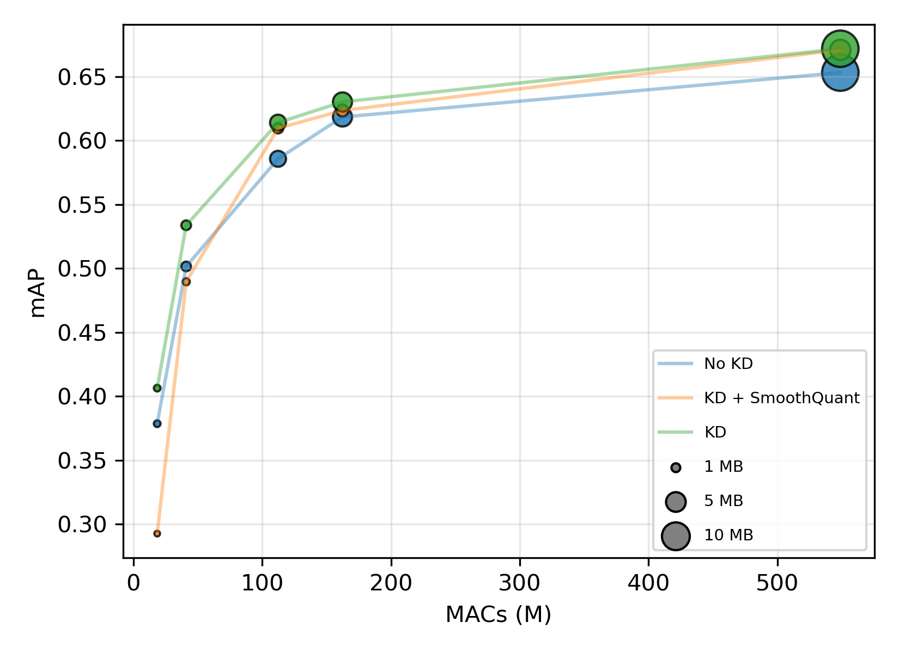

- **Context:** Master's thesis, Polytechnique Montréal × Atelier7Hz
- **Focus:** Sound event detection on edge devices
- **Status:** First-author paper in preparation (The repository is currently under NDA, but will be released alonside the paper.)
- **Stack:** PyTorch, Hydra, Ray Tune/Optuna, ONNX

Sound event detection models are accurate but too large for low-power devices. This project compresses an ensemble of strong audio models into a small student that can run on a Raspberry Pi 4B.

## Results so far

- **Teacher ensemble:** built an ensemble that surpasses the state of the art on FSD50K (+0.4 mAP) with 93.7% fewer parameters.
- **Distillation method:** designed a confidence-weighted multi-teacher method that distills BEATs, PaSST, AST and MobileNetV3 into an EfficientAT student. The student reaches **67.05 mAP**, above every individual teacher (all below 65.3).
- **Deployment:** mapped the accuracy-compute Pareto front across pruning, INT8 quantization and combined schemes, to pick operating points for the Raspberry Pi 4B.

<figure style="text-align:center">
  
  <figcaption>Accuracy versus compute for compressed students on FSD50K. Marker area shows model size.</figcaption>
</figure>
## Engineering

- Wrote custom C++/CUDA kernels for mel-spectrogram computation (shared-memory 2D tiling), a **2x speedup** over torchaudio on an RTX 5090 during training.
- Rewrote the inherited training pipeline (PyTorch, Hydra, Ray Tune/Optuna, ONNX) for scene classification and flyover detection. Removing unnecessary CPU-GPU synchronization calls made training **13% faster**.

A first-author paper is in preparation.
