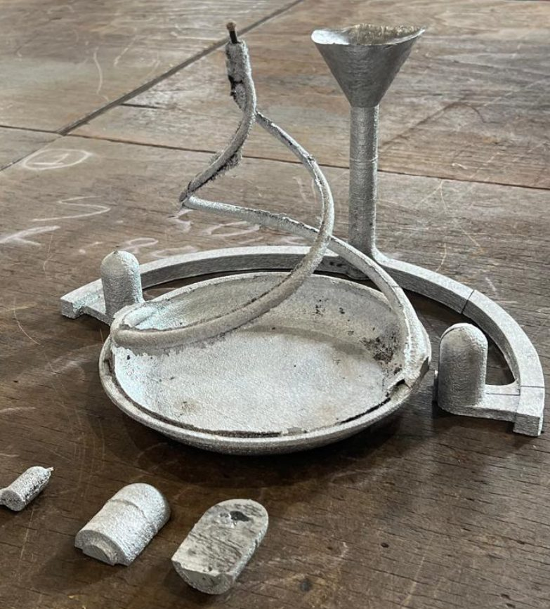
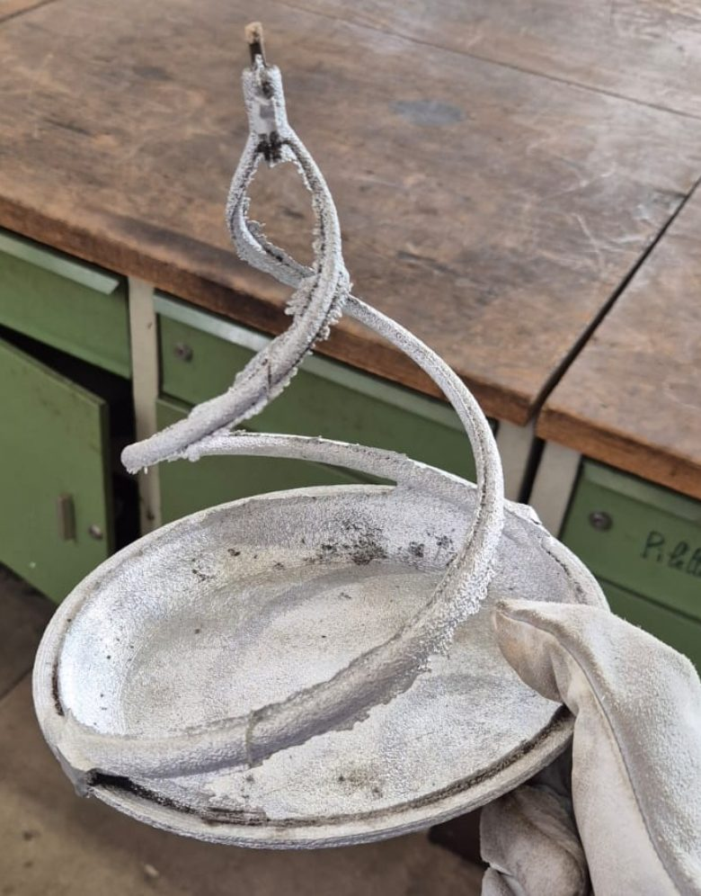
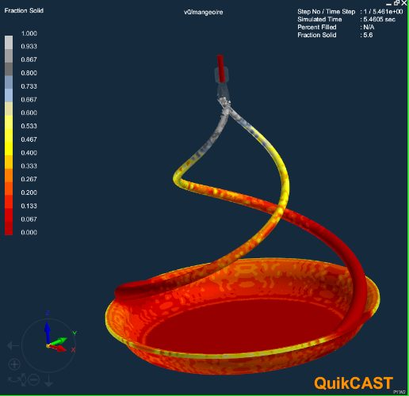
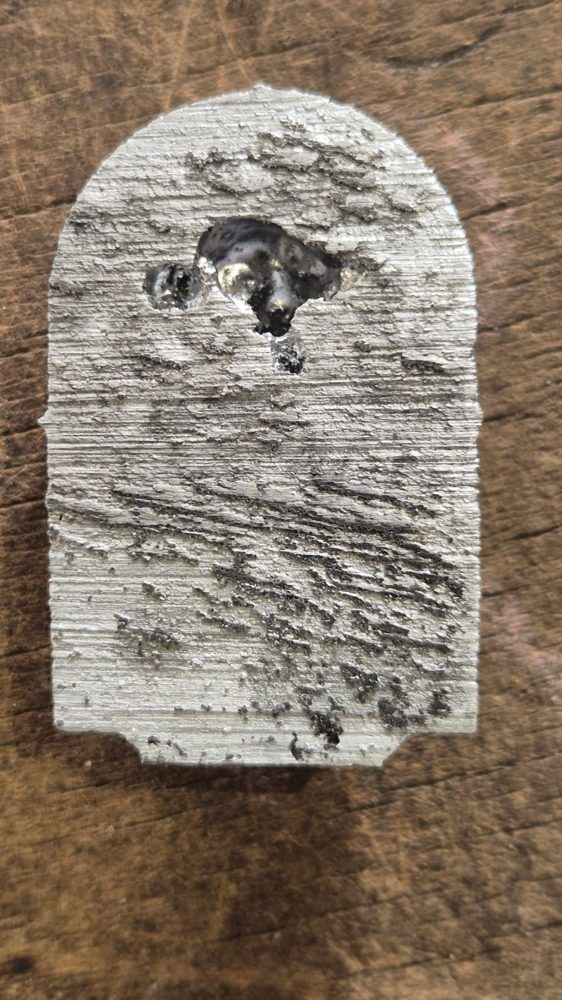
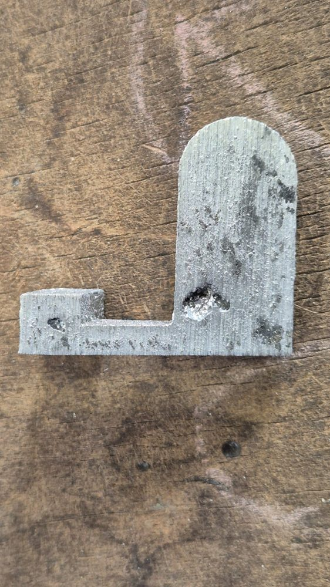

- **Contexte :** Projet de fonderie Arts et Métiers (équipe de 3), automne 2024
- **Outils :** CATIA V5, ESI QuikCAST (simulation thermique et de remplissage), moule en sable imprimé en 3D

- [Rapport complet (PDF)](/assets/pdf/foundry_report.pdf)
- [Présentation (images) (PDF)](/assets/pdf/foundry_presentation.pdf)

Nous avons conçu la base d'une mangeoire à oiseaux (une coupelle fine avec deux bras hélicoïdaux), de la CAO jusqu'à la pièce en aluminium réelle, coulée à la fonderie de l'école.

  

    
  

  

    
  

À gauche : le brut de fonderie à la sortie du moule, avec ses masselottes et ses canaux de coulée. À droite : la pièce après parachèvement.

**Conception et simulation**

- Comparaison des orientations de coulée sous QuikCAST et conservation de celle qui éloignait la retassure du bossage de vis mince, puis épaississement de ce bossage pour pouvoir y placer une masselotte.
- Dimensionnement de trois masselottes cylindro-sphériques en utilisant les règles du module, de la contraction volumique et de la distance d'alimentation ($$V_{masselotte} \geq R\,S\,V_{pièce}$$, avec $$R = 5,5\%$$).
- Dimensionnement d'un système de remplissage à deux attaques : temps de remplissage calculé à partir de la section la plus fine ($$M' = 1,16$$ mm, $$t_r \approx 1,4$$ s), puis itération sur l'efficacité hydraulique pour obtenir la section de la descente de charge.
- Re-simulation de l'ensemble du tracé : l'empreinte se remplit en environ 1,5 s avec un métal encore 38 °C au-dessus du liquidus, et la fin de solidification s'effectue à l'intérieur des masselottes.

Simulation QuikCAST de la fraction solide.

**Moule et moulage**

- Séparation du moule pour l'impression 3D sable (un noyau conique pour les bras hélicoïdaux, un bouchon pour le nettoyage de la masselotte supérieure, et des assemblages à rainure et languette), puis flambage du moule et coulée.
- Le rendement mesuré correspond très exactement aux prédictions : un ratio métal/pièce de 2,89, contre 2,93 attendu.
- La découpe des masselottes a montré que les retassures se sont bien installées à l'intérieur de celles-ci, comme prévu.

  

    
  

  

    
  

Masselottes sectionnées : la masselotte supérieure (à gauche) et une masselotte latérale avec une partie du canal (à droite). Les retassures se trouvent dans les masselottes et non dans la pièce.

- Quelques petites porosités de retassure sont restées sur la coupelle. Nous les avons attribuées à la séparation du front de solidification à travers la coupelle, ce qu'une épaisseur évolutive de la coupelle aurait permis de corriger.

Équipe : Maxence Chauvel, Dorian Mandrino, Mateo Mangialomini.