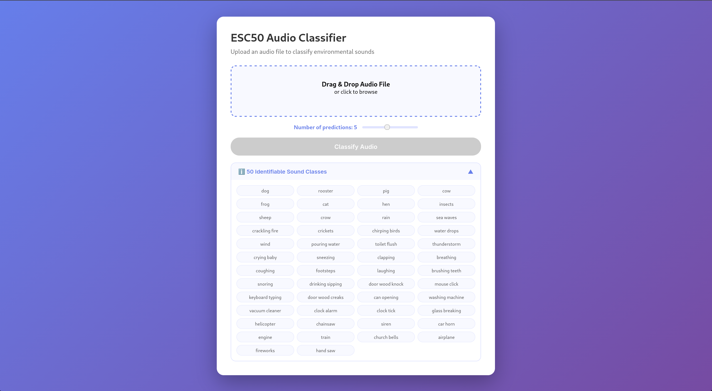

- **Context:** Personal project, 2026
- **Stack:** PyTorch, librosa, FastAPI, Docker, HuggingFace Spaces

An end-to-end deep learning project I built to learn the full pipeline. I extended the CNN from Salamon & Bello (2017) from 10 to 50 classes and kept its accuracy by using data augmentation techniques, which matter a lot on a small dataset like ESC-50. I then deployed the model as a FastAPI + Docker endpoint with a real-time web UI.

[Live demo](https://mateo496-esc50-model.hf.space/) · [Code](https://github.com/mateo-496/esc50-sound-classification)

