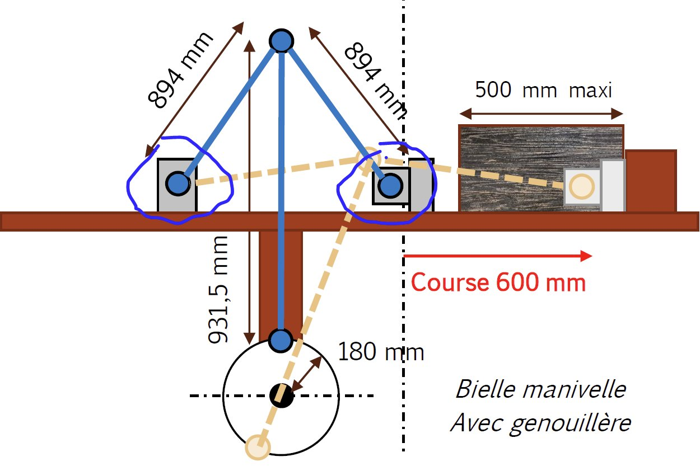
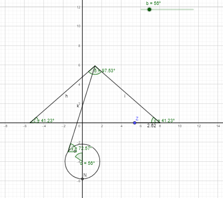
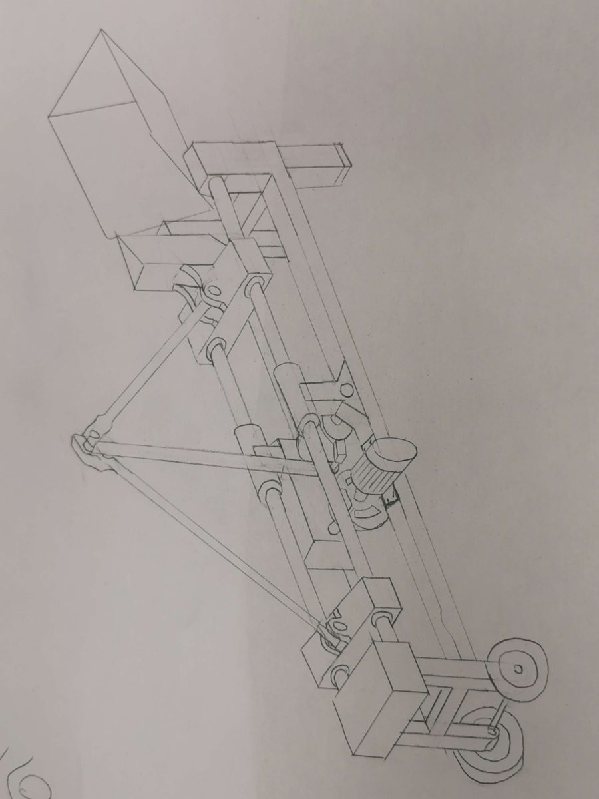

- **Contexte :** Projet de conception mécanique (COSI), Arts et Métiers, fév.–mai 2024, équipe de 4
- **Mon rôle :** Simulation géométrique du mécanisme, conception des axes, des arbres et engrenages du réducteur, liaisons cannelées, fixation de la manivelle, actionneur de butée de bûche, bâti
- **Méthodes :** Analyse fonctionnelle (FAST, SysML, diagramme pieuvre), cinématique (GeoGebra), dimensionnement des arbres et des engrenages

Le client souhaitait une fendeuse de bûches électrique capable de fendre des bûches jusqu'à 400 mm de diamètre et 500 mm de long, à raison de 250 à 300 bûches par heure, alimentée par un moteur triphasé de 2,2 kW. Une force de fendage de 90 kN étant bien supérieure à ce que ce moteur peut délivrer directement, nous avons opté pour une **conception cinétique** : le moteur accélère lentement un volant d'inertie, et l'énergie emmagasinée est libérée en un seul cycle par le biais d'une manivelle, d'une bielle verticale et d'un mécanisme à genouillère qui actionne le couteau.

<figure style="text-align:center">
  
  <figcaption>Mécanisme à manivelle et genouillère : une manivelle de 180 mm entraîne une course de couteau de 600 mm.</figcaption>
</figure>

## Chiffres clés

- **Énergie par cycle :** 8,1 kJ, stockée dans un volant d'inertie dimensionné pour une baisse de vitesse de 25 %. Le moteur nécessite environ 1,1 kW pour le recharger entre chaque cycle, ce qui reste dans le budget de 2,2 kW.
- **Cinématique :** le couteau frappe la bûche à environ 5,5 m/s et atteint un pic à 6,8 m/s.
- **Efforts :** une analyse statique à l'impact donne 186 kN dans la bielle verticale et 137 kN dans chaque biellette de la genouillère.
- **Réducteur :** trois étages (6 × 5 × 4 = 120:1), transformant 192 N·m sur l'arbre moteur en 23 kN·m en sortie.

## Conception du réducteur et du mécanisme

- Réalisation de la simulation géométrique du mécanisme à manivelle et genouillère, utilisée pour fixer les longueurs de bielles et vérifier la course et la vitesse du couteau.
- Conception des axes du mécanisme.
- Dimensionnement des arbres en torsion, et de l'arbre de sortie de 115 mm sous sollicitation combinée de flexion et de torsion (critère de von Mises).
- Dimensionnement d'engrenages sur mesure à l'aide du modèle de résistance à la flexion des dents. Les couples en sortie étant trop élevés pour des engrenages standard du commerce, les deux derniers étages utilisent de l'acier trempé 35NCD6.
- Conception de liaisons cannelées pour les engrenages amovibles et la fixation de la manivelle de sortie.

<figure style="text-align:center">
  
  <figcaption>Modèle GeoGebra du mécanisme : le curseur d'angle de manivelle pilote la genouillère et la position du couteau.</figcaption>
</figure>

## Bilan

La conception finale satisfait la force de fendage, le temps de cycle et la durée de vie de 30 ans. Elle pèse **335 kg pour un objectif initial de 250 kg** : nous avons privilégié la résistance à la masse sur les pièces les plus chargées, et les engrenages pleins pourront être allégés par des ajournements lors d'une prochaine itération.

<figure style="text-align:center">
  
  <figcaption>Croquis à main levée de la machine complète : moteur, volant d'inertie, réducteur, manivelle, genouillère et coulisseau.</figcaption>
</figure>

Équipe : Harold Gardon, Dorian Mandrino, Mateo Mangialomini, Alexandre Poncelet.