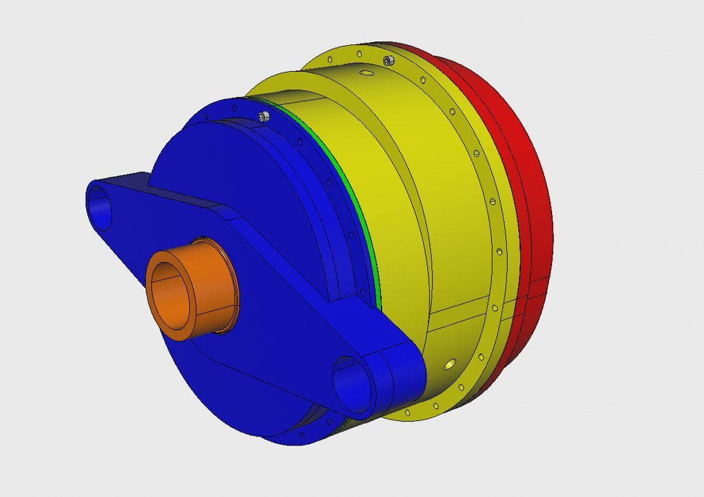
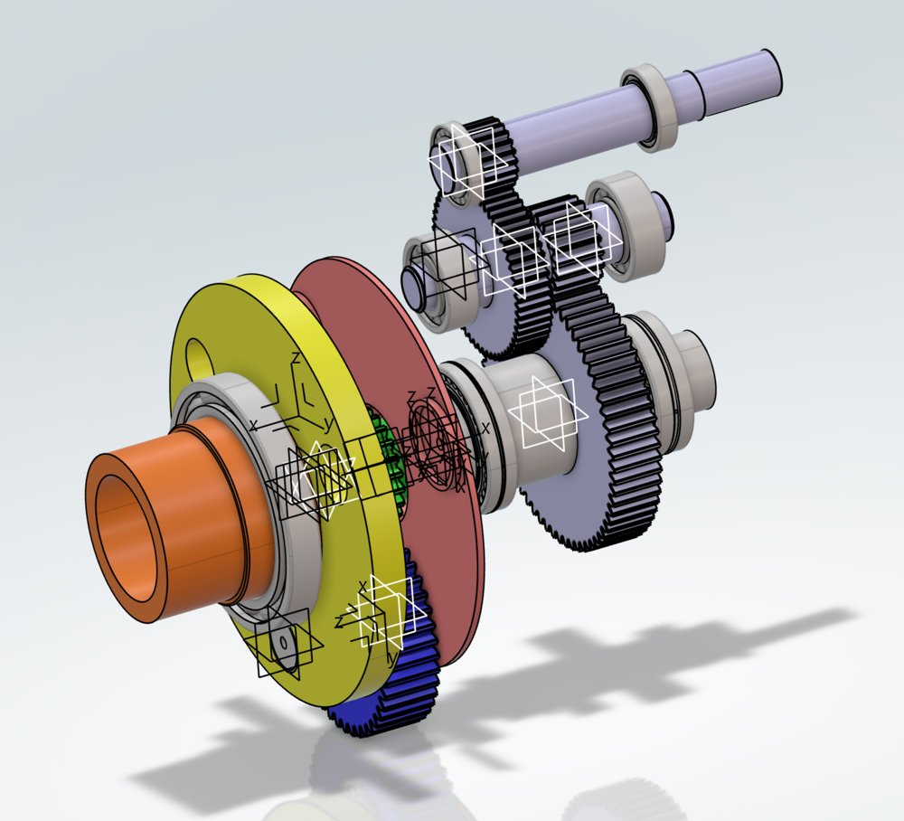
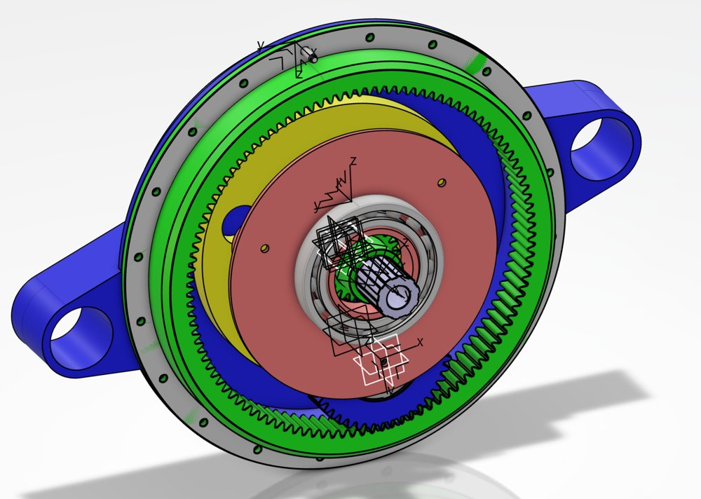
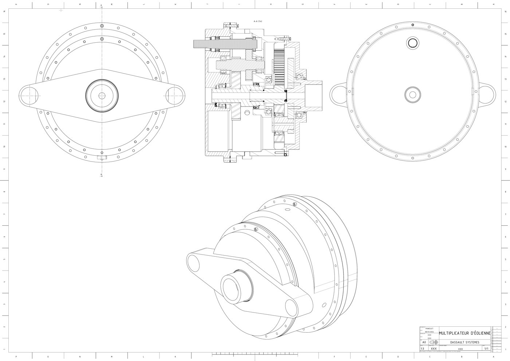
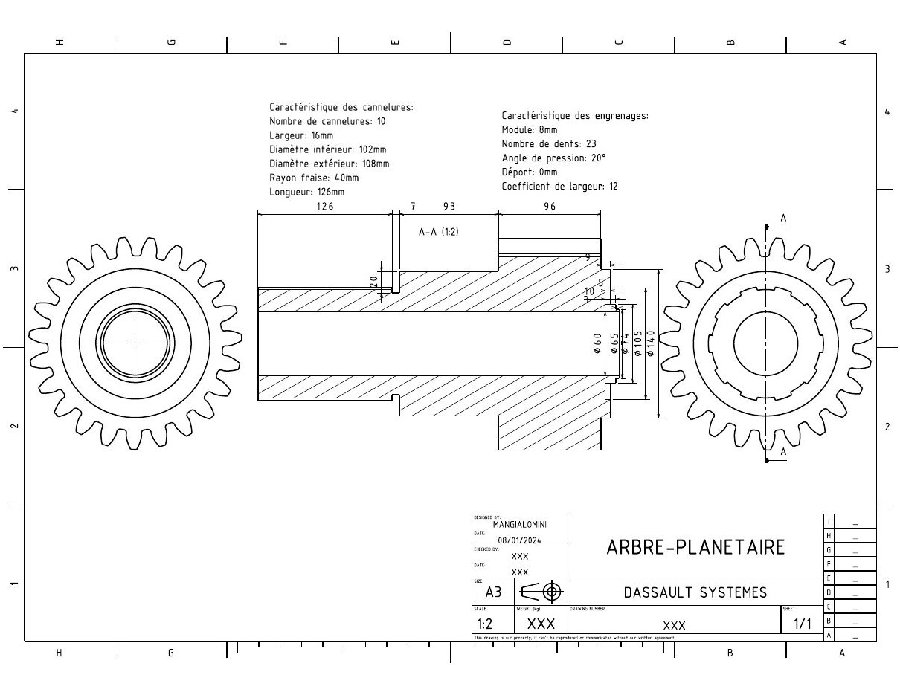
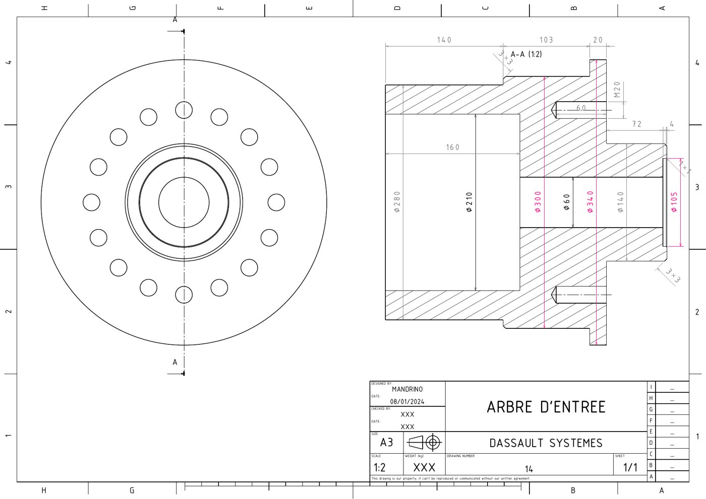
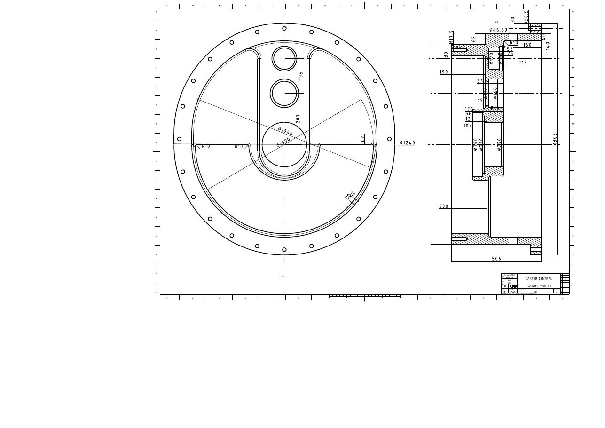
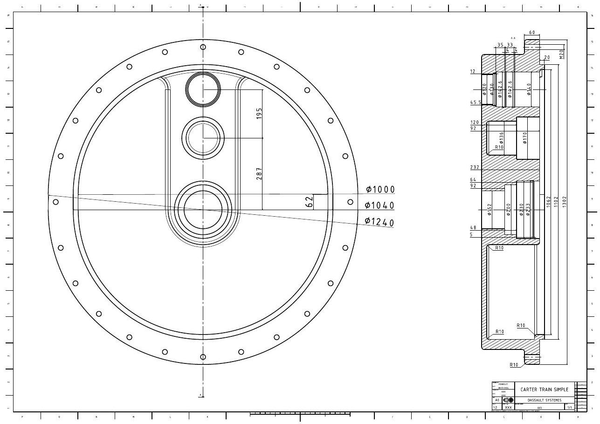

- **Contexte :** Projet de conception détaillée et maquette numérique (DMU), Arts et Métiers, 2023–2024 (équipe de 4)
- **Outils :** Dassault 3DEXPERIENCE / CATIA (conception de pièces, assemblage, simulation cinématique, mise en plan 2D)
- **Ma partie :** Modélisation de ma part des pièces et plan de fabrication détaillé de l'arbre solaire (pignon central)

- [Notice technique (PDF)](/assets/pdf/wind_gearbox_report.pdf)
- [Plans 2D](#drawings)

Nous avons conçu le multiplicateur de vitesse placé entre le rotor et la génératrice d'une éolienne de **200 kW**, à partir d'un cahier des charges, d'un schéma cinématique minimal et de roulements SKF imposés. Le rotor tourne à 50–70 tr/min ; la génératrice asynchrone requiert environ 3 025 tr/min.

<figure style="text-align:center">
  
  <figcaption>Maquette numérique complète avec ses trois carters en aluminium.</figcaption>
</figure>

## Architecture

- **Étage planétaire** (solaire Z=23, 3 satellites Z=43, couronne Z=109, module 8 mm) entraîné par le porte-satellites, rapport $$1 + \frac{109}{23} \approx 5,74$$.
- **Deux étages parallèles à dents droites** (57/21 et 63/19), rapport $$\frac{57}{21}\cdot\frac{63}{19} = 9$$.
- **Multiplication globale ≈ 51,7**, soit 3 025 tr/min en sortie pour ≈ 58,6 tr/min en entrée au rotor.
- Arbres du solaire et du porte-satellites creux, permettant le passage d'une tige de 60 mm le long de tout l'axe du multiplicateur.
- Étanchéité assurée par des joints à lèvres, des joints plats et un V-ring ; lubrification par barbotage avec bouchons de remplissage/vidange et jauge de niveau d'huile.
- Engrenages soit taillés dans la masse de l'arbre, soit fixés par clavette/cannelures et épaulements de roulements ; dimensions globales à ±3% près de l'enveloppe imposée.

  

    
  

  

    
  

À gauche : train d'engrenages sans les carters. À droite : étage planétaire (un satellite modélisé).

## Résultat

Nous avons livré la maquette 3D, une séquence d'assemblage, une nomenclature (matériaux et procédés de fabrication pour chaque pièce), des plans 2D et une simulation cinématique fonctionnelle. La mise en place de la simulation cinématique a nécessité plusieurs itérations, résolues principalement en ajustant les dimensions des pièces qui entraient en collision.

## Plans

Cliquez sur un plan pour l'ouvrir en PDF haute résolution.

<figure style="text-align:center">
  
  <figcaption>Plan d'ensemble.</figcaption>
</figure>

  

    
    
Arbre solaire.

  

  

    
    
Arbre d'entrée.

  

  

    
    
Carter central.

  

  

    
    
Carter de l'étage train classique.

  

Équipe : Harold Gardon, Dorian Mandrino, Mateo Mangialomini, Alexandre Poncelet.